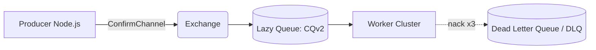

<div align="center">
  
</div>

<p align="center">
  <a href="https://linkedin.com/in/SEU-LINKEDIN" target="_blank">
    
  </a>
  <a href="mailto:seu-email@gmail.com">
    
  </a>
  
  
</p>

---

### 💻 `whoami`

Desenvolvedor Back-end com foco na construção de sistemas tolerantes a falhas, processamento assíncrono de eventos e APIs RESTful de alta disponibilidade.

```yaml
stack_principal:
  languages: [Java 17+, TypeScript, JavaScript, SQL]
  frameworks: [Spring Boot 3, Fastify, Express]
  messaging: [RabbitMQ (AMQP 0-9-1)]
  databases: [PostgreSQL, Prisma ORM, Spring Data JPA / Hibernate]
  infrastructure: [Docker, Docker Compose, Linux, Git, Maven]
  testing: [JUnit 5, Mockito]
```

---

### 🚀 Destaques de Arquitetura & Projetos

#### 1. [RabbitMQ — Ingestão Massiva de 4 Milhões de Logs](https://github.com/jacaze/Projeto-RabbitMQ)
> **Problema:** Ingerir e processar 4.000.000 de eventos de logs sem estourar o limite de memória RAM e com garantia de entrega.

- ⚙️ **Soluções implementadas:**
  - **Lazy Queues + CQv2:** Persistência direta em disco para evitar pressão na RAM mesmo sob backlog massivo.
  - **ConfirmChannel & Publisher Confirms:** Confirmação explícita de publicação sem perda silenciosa de dados.
  - **Dead Letter Exchange (DLQ):** Quarentena automática para mensagens com falha após 3 tentativas (`x-max-delivery-count: 3`).
  - **Backpressure & Concorrência:** `prefetch(1)` com balanceamento justo entre workers.
- 📊 **Resultado:** Taxa média de **~42.000 msgs/segundo** com **0% de perdas** e recuperação automática de workers.




---

#### 2. [Banking API — Core Bancário com Spring Boot 3](https://github.com/jacaze/crud-clientes-springboot)
> **Escopo:** API RESTful robusta para gestão de clientes, contas bancárias e transações financeiras.

- ⚙️ **Práticas de Engenharia:**
  - Persistência com **Spring Data JPA** e banco **PostgreSQL** rodando em **Docker Compose**.
  - Regras de negócio restritas: geração automática de agência/conta, validação de vínculos e integridade financeira com *Soft Delete*.
  - **100% de cobertura de testes unitários** nos fluxos web/controllers com **JUnit 5** e **Mockito**.

---

#### 3. [Obras Jooy — Gestão de Almoxarifado em Canteiro](https://github.com/jacaze/obras-jooy)
> **Escopo:** Sistema corporativo de alta disponibilidade para controle de insumos e cautela de ferramentas.

- ⚙️ **Stack:** **Node.js (Fastify)** + **TypeScript**, **Prisma ORM**, autenticação stateless com **JWT**, validação estrita com **Zod** e documentação com **Swagger / OpenAPI 3.0**.
- Arquitetura preparada para cenários de conectividade instável (*Offline First* com Service Workers e IndexedDB).

---

### 📈 Contribuições no GitHub

<picture>
  <source media="(prefers-color-scheme: dark)" srcset="https://raw.githubusercontent.com/jacaze/jacaze/output/github-contribution-grid-snake-dark.svg">
  <source media="(prefers-color-scheme: light)" srcset="https://raw.githubusercontent.com/jacaze/jacaze/output/github-contribution-grid-snake.svg">
  
</picture>

---
<div align="center">
  <sub>Desenvolvido com foco em código limpo, resiliência e boas práticas de arquitetura.</sub>
</div>
